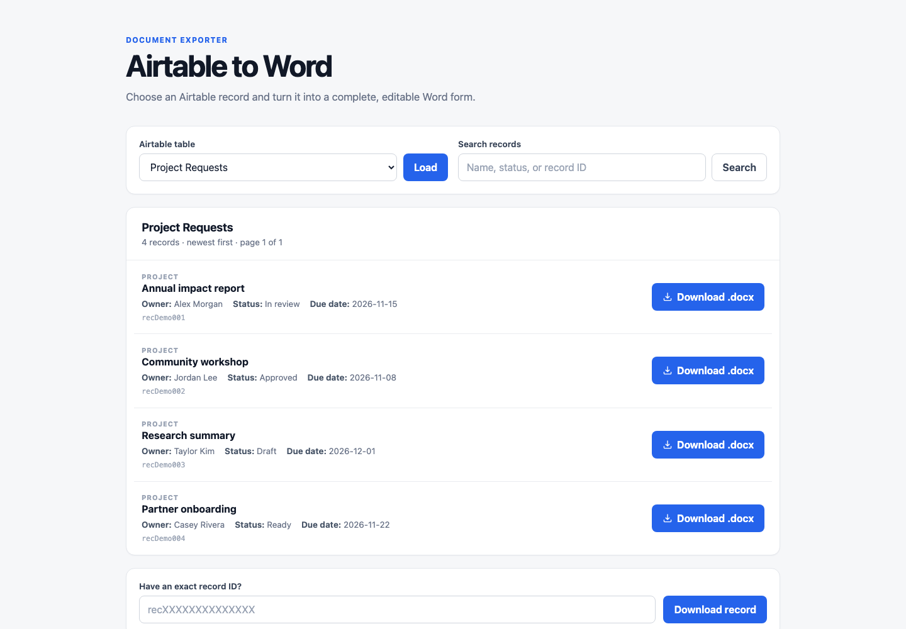
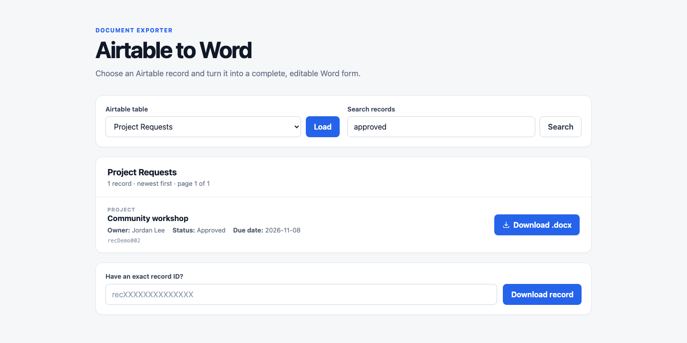

# Airtable to Word

A local, read-only web app that reads an Airtable base schema, lets you choose a record, and creates an editable Microsoft Word (`.docx`) form. The form includes every field from the table schema, even when the selected Airtable record has no value for that field.

## Screenshots

The screenshots below use sample data.

### Record browser



### Filtered records



## Airtable access required

Create a Personal Access Token at <https://airtable.com/create/tokens> with access limited to the intended base and these scopes:

- `schema.bases:read`
- `data.records:read`

Do not commit or send the token. Keep it only in your local `.env` file.

The Base ID begins with `app`. You can find it in Airtable's API documentation for the base or in the base URL.

## Setup

```bash
uv sync
cp .env.example .env
```

Open `.env`, replace the placeholder token and Base ID, then run:

```bash
uv run python app.py
```

Open <http://127.0.0.1:5000>. Choose a table and record, then click **Download Word form**.

## Current behavior

- Airtable is read-only; editing the Word document does not modify Airtable.
- The record browser follows all Airtable API pagination cursors, sorts the full result by creation time, and displays 100 records per page with the newest records first.
- The Word file renders attachments as filename/URL text, linked records as their Airtable record IDs, and blank fields as editable blank cells.
- Schema responses are cached until the app restarts or `/refresh-schema` is posted to.

## Tests

```bash
uv run pytest -q
```
